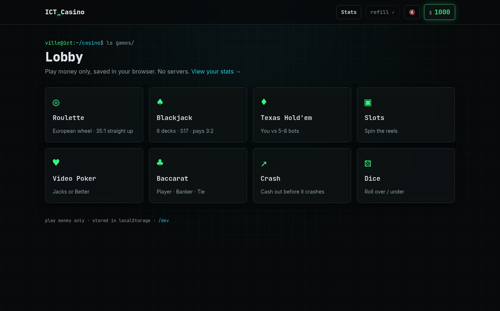
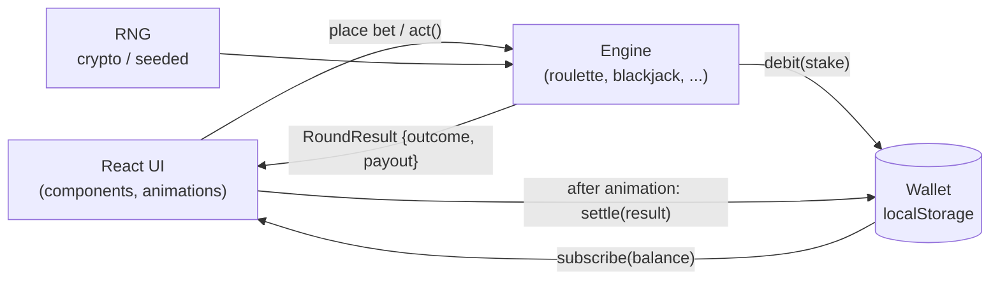

<div align="center">

# `> ICT-Casino_`

**A terminal-flavoured casino for ICT & software engineering students. Play money only, no server.**


🔗 **Live demo:** https://villeboee.github.io/ICT-Casino/



</div>

---

## `$ cat about.txt`

ICT-Casino is a browser casino built by and for university ICT / software engineering classmates. It runs entirely in the browser: your chips live in `localStorage`, and there are no accounts, no backend and **no real money**. The look is an IDE / terminal (dark surfaces, monospace, neon accents), and the code keeps a clean split between pure game logic and the UI.

## `$ ls games/`

| Game | Rules | Status |
|---|---|---|
| 🎡 Roulette | European, single zero, straight up pays 35:1 | ✅ Engine done · UI planned |
| 🃏 Blackjack | 6 decks, pays 3:2, dealer stands on soft 17, double, split up to 4 hands | ✅ Engine done · UI planned |
| ♠️ Texas Hold'em | You vs 5+ bots (tight / loose / bluffer) | 🛠️ Planned |
| 🎰 Slots | Reels, paytable, RTP | 🛠️ Planned |
| 🂡 Video Poker | Jacks or Better | 🛠️ Planned |
| 🎴 Baccarat | Punto Banco | 🛠️ Planned |
| 📈 Crash | Rising multiplier, cash out in time | 🛠️ Planned |
| 🎲 Dice | Over/under with adjustable odds | 🛠️ Planned |

Status reflects what is in `src/engine/` and the open issues; see the [roadmap (#34)](../../issues/34).

## `$ man play`

- **Wallet:** you start with **1,000 chips**. Your balance is saved in your browser's `localStorage` (key `ict-casino:wallet`), so it is per browser and per device.
- **Daily refill:** broke? Claim **500 free chips** once every 24 hours.
- **Betting:** bets are whole chips (positive integers) and can't exceed your balance. The stake is taken off when you place the bet, and winnings are credited when the round finishes.
- **History:** the wallet keeps your last 200 rounds.
- **Reset:** clearing site data (or the in-app reset) starts you again at 1,000 chips.

## `$ ./features --list`

- **Terminal theme:** near-black surfaces, neon green `#39ff88` and cyan `#22d3ee` accents, self-hosted JetBrains Mono + Inter, a grid background and scanline overlay that respect `prefers-reduced-motion`.
- **Animations:** Framer Motion for card dealing, wheel spins, chips and balance count-ups *(in progress)*; optional Howler sounds with a mute toggle *(planned)*.
- **Fair RNG:** real play uses `crypto.getRandomValues`. Tests use a seeded deterministic RNG (mulberry32), so any round can be replayed exactly.
- **Honest house edge:** payouts follow real casino tables, so the house keeps its edge (for example 1/37 ≈ 2.7% on every European roulette bet, which the tests check). You will lose chips over time. That is the lesson.

## `$ npm run quickstart`

Requires Node.js 20+.

```bash
git clone https://github.com/VilleBoee/ICT-Casino.git
cd ICT-Casino
npm ci          # install exact dependencies
npm run dev     # start the dev server
npm test        # run the Vitest suite
npm run build   # type-check + production build into dist/
```

Also available: `npm run lint` (oxlint) and `npm run preview`.

## `$ deploy --target pages`

Every push to `main` runs `.github/workflows/deploy.yml`: `npm ci` → tests → build → upload `dist/` → deploy to GitHub Pages. Vite's `base` is set to `/ICT-Casino/`.

> ⚠️ GitHub Pages needs a **public repo** or **GitHub Pro** (free with the Student Developer Pack). Set *Settings → Pages → Source* to **GitHub Actions**.

## `$ cat stack.json`

| Layer | Tech |
|---|---|
| UI | React 19, TypeScript, Tailwind CSS 4, Framer Motion |
| Audio | Howler |
| Build | Vite 8 |
| Tests / lint | Vitest, oxlint |
| Hosting | GitHub Pages via GitHub Actions |

## `$ tree`

```text
ICT-Casino/
├── .github/workflows/deploy.yml   # Pages CI/CD
├── public/favicon.svg
├── src/
│   ├── engine/                    # pure TS game logic, no React
│   │   ├── types.ts               # shared game-state types
│   │   ├── rng.ts                 # crypto RNG + seeded RNG
│   │   ├── wallet.ts              # localStorage wallet
│   │   ├── cards.ts               # deck + multi-deck Shoe
│   │   ├── roulette.ts            # European roulette
│   │   ├── blackjack.ts           # Blackjack round
│   │   ├── index.ts
│   │   └── *.test.ts              # Vitest suites
│   ├── theme/                     # design tokens + docs
│   ├── App.tsx
│   ├── main.tsx
│   └── index.css
├── index.html
├── vite.config.ts
└── package.json
```

## `$ cat architecture.md`

The **engine** (`src/engine/`) is framework-free TypeScript that owns all rules, randomness and money. The **UI** only renders engine state and calls engine actions; it never decides an outcome.



**The spin / settle contract:**
1. The engine **debits the stake immediately** (`wallet.debit`).
2. The outcome is **decided before any animation**. `spin()` returns the winning number, and the wheel animates to land on it.
3. The payout comes back **separately and isn't credited yet**. The UI calls `wallet.settle(result)` once the ball lands or the cards are revealed, so the balance never gives the result away early.

## `$ who`

Built by a team of AI agents directed by Ville:

| Agent | Role |
|---|---|
| **React-UI** | Theme, layout, components, animations (`ui` issues) |
| **MiddleWare+Logic** | Game engines, wallet, RNG, tests (`logic` issues) |
| **GitHubManager** | Repo, issues, CI/CD, reviews & merges (`infra` issues) |

**Workflow:** issues are tiered **P0 → P8** by build order (see [roadmap #34](../../issues/34)), and each issue lists what it depends on. Use one branch per issue (`feat/<issue>-name`) with a PR into `main` that has passing tests and build. See [CONTRIBUTING.md](CONTRIBUTING.md).

## `$ npm run sim`

Seeded long runs of every game engine, measured vs theoretical house edge (edge = (staked − returned) / staked). The run is deterministic; change it with `SIM_SEED=1 SIM_SCALE=5 npm run sim`. `npm test` runs the exact and short Monte Carlo checks in `src/engine/house-edge.test.ts`.

| Game | Bet | Rounds | Measured edge | Theoretical edge | Note |
|---|---|---:|---:|---:|---|
| Roulette | red/black | 1,000,000 | 2.76% | 2.70% |  |
| Roulette | straight up | 1,000,000 | 3.53% | 2.70% |  |
| Blackjack | basic strategy | 300,000 | 0.59% | 0.45% | theory ≈0.4-0.5% for 6D S17 DAS; per initial bet |
| Slots | 10 lines | 1,000,000 | 4.14% | 4.48% |  |
| Video Poker 9/6 | 5 coins (max-coin royal) | 500,000 | 2.52% | 0.46% | theory is optimal play; this sim uses a simple hold strategy (~2% worse) |
| Video Poker 9/6 | 1-4 coins | 500,000 | 2.96% | 1.82% | theory is optimal play; this sim uses a simple hold strategy (~2% worse) |
| Baccarat | banker | 1,000,000 | 1.01% | 1.06% |  |
| Baccarat | player | 1,000,000 | 1.29% | 1.24% |  |
| Baccarat | tie 8:1 | 1,000,000 | 14.32% | 14.36% |  |
| Crash | cash out 2x | 1,000,000 | 1.00% | 1.00% |  |
| Crash | cash out 10x | 1,000,000 | 0.84% | 1.00% |  |
| Dice | under 50 | 1,000,000 | 0.94% | 1.00% |  |
| Dice | under 10 | 1,000,000 | 1.00% | 1.00% |  |
| Texas Hold'em | vs bots | - | - | 0.00% | no rake: chips only move between players |

Notes: video poker theory is for optimal play (5 coins: 99.54% return thanks to the 4000-coin max-coin royal; 1-4 coins: 98.18%), and the simulator uses a simpler hold strategy. Gaps on high-variance bets (roulette straight up, crash 10x) are within a couple of standard errors at 1M rounds. Payouts are rounded down to whole chips, which adds a tiny extra edge on very small bets.

## `$ cat DISCLAIMER`

ICT-Casino is for **entertainment and education only**. It uses virtual chips with no monetary value, which can't be bought, sold or cashed out. No real-money gambling is involved or encouraged. If gambling is a problem for you or someone you know, please seek support.

## Sounds

All sound effects in `public/sfx/` are original, synthesized by `scripts/gen-sfx.mjs` (ffmpeg). They contain no third-party samples and are dedicated to the public domain (CC0). To regenerate them, run `node scripts/gen-sfx.mjs`. The top-bar toggle mutes all sound, and the choice is saved in localStorage. With no saved choice the game stays silent until the first interaction.
